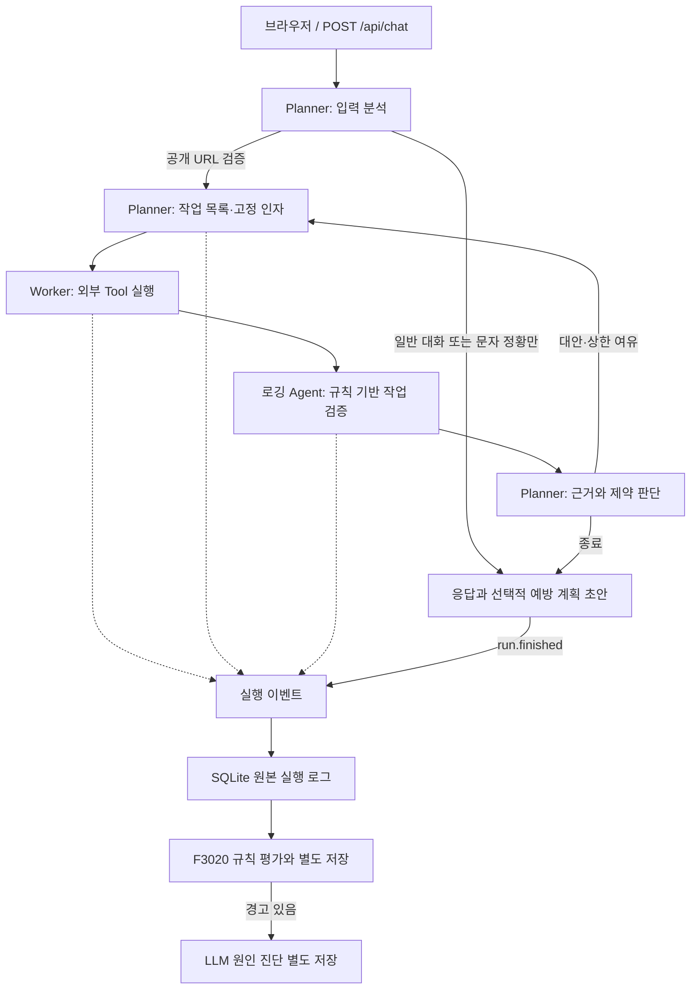

# Agent 설계서

## 역할과 단계별 계약

| 단계 | 입력 → 출력 | LLM 사용 조건 |
|---|---|---|
| Planner 분석·계획 | 메시지, 입력 모드, 이전 세션 문맥 → 분류, 검증할 공개 URL, 기간과 Tool 목록 | 자연어 의도와 조회 선택이 필요할 때. 단순 인사, 문자만의 규칙 평가, 입력 검증에서는 생략 |
| Worker | `PlanBatch` → 작업별 시도와 결과 | 기본 조회 기간을 조정할 수 있는 실패에서만 재시도·건너뛰기·계획 변경을 선택 |
| 로깅 Agent의 실행 검증 | 작업·실제 요청과 결과·이전 호출 → `ValidationResult` | 순서, 인자, 상한 대조는 규칙. 구조가 맞는 불완전 보고서의 추가 조회와 수동 검토가 모호할 때 후속 조치 선택 가능 |
| Planner 판단·응답 | 검증 결과, 사용자 제약, 재계획 횟수 → 다음 작업 또는 최종 판단·행동 | 유효한 대안의 선택이나 검증된 근거·행동 강조 순서에 사용. 위험 분류와 근거의 적합성은 규칙 |
| F3020 종료 평가 | 저장된 실행 로그 → 경고/정상/판정 불가와 선택적 진단 | 규칙 경고가 있을 때만 진단 호출. 종료 후 진단 문장은 Planner에 전달하지 않음 |

## 메시지와 실패 처리

- `PlanBatch`는 실행 ID·계획 차수·작업 목록을, `Task`는 작업 ID·Tool·입력 인자·고정 인자·고정 조건을 담습니다. URL은 항상 고정하며 사용자가 조회 기간을 지정하면 그 기간도 고정합니다.
- `Attempt`는 실제 Tool·입력·시도 번호·결과를, `WorkResult`는 실패 코드와 Planner에게 보내는 계획 변경 요청을 담습니다. 여유가 있는 urlscan.io 기본 조회 기간만 같은 Tool에서 최대 한 번 바꿉니다.
- `ValidationResult`는 검증 상태, 규칙 코드, 채택할 작업과 재계획 요청을 전달합니다. 계획 외 호출, 인자·결과 불일치가 있는 묶음의 근거는 제외합니다.
- 증거 부족·조건 미충족·실행 검증 이상이 있고 다른 허용 Tool이 남으면 재계획합니다. 기본 상한은 2회입니다. 인증·키·필수 인자 오류에는 불필요한 Worker 호출을 피하고, 소스 일부 실패 시 확보한 근거를 유지합니다. 모델 타임아웃·잘못된 선택은 규칙 경로로 이어집니다.
- 비교 모드에서는 동일 그래프의 `ScamshieldAgent`가 직접 Tool을 실행합니다. 서버 기본은 `PlannerAgent`이며 설정 스위치는 [README](../README.md)에 있습니다.

## 로그·기억·저장 경계

- `execution_events`는 세션 참조·실행 ID·순번·UTC 시각·허용된 이벤트 필드를 SQLite에 기록합니다. 수정은 트리거로 차단합니다. 저장 실패는 메인 경로에서 격리합니다.
- F3020의 `execution_evaluations`와 `execution_diagnoses`는 원본 로그와 별도입니다. 기록이 부족하면 판정 불가, 이상이면 근거 이벤트 ID를 표시합니다. 경고 진단에는 원문 대신 규칙 코드와 이벤트 순번을 전달하며 진단 실패 시 규칙 판정은 남습니다.
- 실행 비교용 URL HMAC 키는 실행마다 만들고 영속 저장하지 않습니다. 로그에 원본 URL이나 인증정보를 기록하지 않습니다.
- 세션 기억에는 마지막 검증 URL, 조건과 정황 분류가 갱신됩니다. 후속 요청에서 조건을 변경해도 같은 세션의 URL을 사용할 수 있습니다. URL 없는 문자 입력은 이전 URL을 가져오지 않습니다. 기억과 미저장 초안은 프로세스 메모리에 있으며, 분석만으로 예방 계획을 저장하지 않습니다.

코드와 확인 사례는 [Planner](../app/scamshield/planner.py), [Worker·메시지](../app/scamshield/work.py), [로그 저장](../app/scamshield/execution_logs.py), [F3021 비교](multi-agent-validation.md), [F3020 평가](logging-agent-evaluation.md)에서 확인할 수 있습니다.
